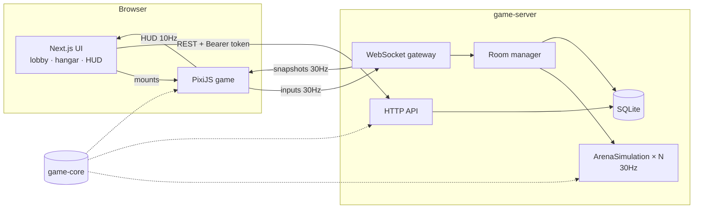
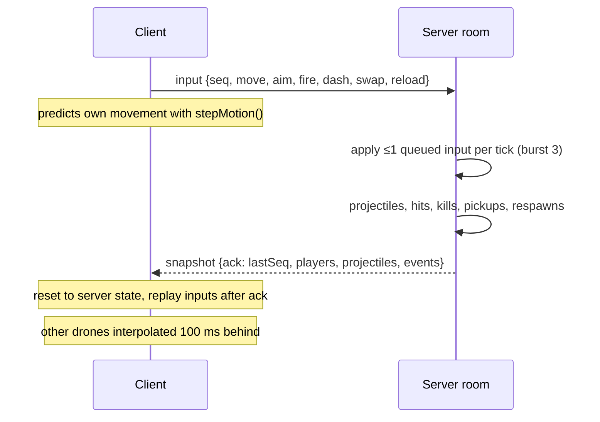

# Skyline Salvagers

Top-down pixel-art drone combat in the browser.

- **Arena** — online multiplayer deathmatch, free-for-all or team, in five arenas. Bots fill empty slots, you can practice against bots alone, or open a private room and share a code with friends.
- **Hangar** — spend credits on weapons (tiered, upgradable to level 3; some kill in one shot), drone frames and paint.
- **Leaderboard** — global ranking from server-computed match results.
- **Salvage** — solo extraction mode in a procedurally generated city; ranked runs are verified by the server.

## Quick start

```bash
pnpm install
pnpm dev     # web on http://localhost:3000, game server on :4000
pnpm test    # vitest across all packages
pnpm typecheck && pnpm lint && pnpm build
```

Requires Node ≥ 22.13 (uses built-in `node:sqlite`) and pnpm. Data is stored in `services/game-server/data/skyline.db`.

| Env (game server) | Default                                       |
| ----------------- | --------------------------------------------- |
| `PORT`            | `4000`                                        |
| `DATABASE_PATH`   | `./data/skyline.db`                           |
| `WEB_ORIGINS`     | `http://localhost:3000,http://localhost:3100` |

| Env (web)             | Default                 |
| --------------------- | ----------------------- |
| `NEXT_PUBLIC_API_URL` | `http://localhost:4000` |

To play with friends on a LAN, start the server with `WEB_ORIGINS` including your LAN web URL and build the web app with `NEXT_PUBLIC_API_URL=http://<your-ip>:4000`.

## Controls

| Input              | Arena                      | Salvage                    |
| ------------------ | -------------------------- | -------------------------- |
| W A S D            | Fly                        | Fly                        |
| Mouse / left click | Aim / fire                 | Aim / fire                 |
| Q · 1 · 2          | Swap primary / secondary   | —                          |
| R                  | Reload                     | —                          |
| Shift              | Dash (30 energy)           | Dash, briefly invulnerable |
| Space              | —                          | Scan for buried salvage    |
| Tab (hold)         | Scoreboard                 | —                          |
| Esc                | Menu (match keeps running) | Pause                      |
| M                  | Mute                       | Mute                       |

## Arena rules

| Mode            | Win condition           | Time limit |
| --------------- | ----------------------- | ---------- |
| Free for all    | First pilot to 15 kills | 4 min      |
| Team deathmatch | First team to 30 kills  | 5 min      |

- 100 hull + 25 shield. Shield regenerates after 3 s without damage. Health and shield pickups respawn every 20 s.
- Respawn after 3 s at the spawn furthest from enemies, with 1.5 s of spawn protection (cancelled when you fire).
- No friendly fire in team mode. Arenas are mirror-symmetric so neither team has a better side.

**Arenas:** Rooftop Relay (balanced), Foundry (corridors and crates), Cryo Vault (ring around a core), Overgrowth (long sightlines), Neon Bazaar (tight alleys).

### Weapons

| Weapon        | Tier | Price | Damage | Notes                                             |
| ------------- | ---- | ----- | ------ | ------------------------------------------------- |
| Pulse Pistol  | 1    | free  | 18     | Starter                                           |
| Storm SMG     | 2    | 800   | 9      | 750 RPM, short range                              |
| Scatter Gun   | 2    | 1,200 | 13 × 7 | Close range                                       |
| Volt Rifle    | 3    | 2,200 | 15     | Accurate automatic                                |
| Rail Sniper   | 4    | 3,800 | 130    | **One-shot kill** from full health + shield       |
| Nova Launcher | 5    | 5,500 | 105    | Splash damage; **one-shot on direct hit at LV 3** |

Each upgrade level adds 12% damage and 15% magazine, and cuts reload time by 8%. You start with 500 credits.

### Rewards

| Source            | Credits                               | Rating                 |
| ----------------- | ------------------------------------- | ---------------------- |
| Kill a pilot      | 30                                    | +100                   |
| Kill a bot        | 12                                    | +40                    |
| Win               | 120                                   | +250                   |
| Death             | —                                     | −10 (match rating ≥ 0) |
| Time played       | up to 40                              | —                      |
| Extracted salvage | loot value (zone multiplier ×1 → ×60) | —                      |

Leaving mid-match still pays for kills so far, but no win bonus.

## Repository layout

```
apps/
  web/            Next.js 16: landing, arena lobby/HUD, hangar, leaderboard, salvage
  game/           PixiJS 8 engine, framework-agnostic
                  exports: "." (Pixi game), "./net" (WebSocket client), "./art" (pixel art data)
services/
  game-server/    Node HTTP API + WebSocket rooms + SQLite persistence
packages/
  game-core/      Pure TypeScript shared by client and server:
                  arena simulation, bots, weapons, cosmetics, market catalogue, arenas,
                  protocol types, rewards, salvage map generation, validation
```

## Architecture



### Netcode

The server runs the only real simulation. Clients send **inputs, never positions**.



- **Prediction and reconciliation:** `stepMotion()` in `game-core` is the same function on both sides, so replaying unacknowledged inputs reproduces the server's result.
- **Interpolation:** remote drones are drawn between the two snapshots around `now − 100 ms`. Projectiles move in straight lines, so they are extrapolated from the latest snapshot instead.
- **Anti-cheat:** an input budget (1 per tick, burst of 3) stops speed hacks by input flooding. Hits use swept segment-vs-circle tests, so fast rail rounds can't tunnel through drones. Loadouts and weapon levels are read from the database when a pilot joins, never from the client.
- **Bots** (`BotBrain`) produce the same `ArenaInput` a human does. They only target what they have line of sight to, lead their shots, path with a BFS flow field, seek health when low, and aim with noise that depends on difficulty.

### Economy and trust

| Client sends       | Server decides                                                 |
| ------------------ | -------------------------------------------------------------- |
| Inputs             | Positions, hits, kills, match result                           |
| `itemId` to buy    | Price, ownership, balance (`credits >= price` in one `UPDATE`) |
| Loadout ids        | Whether you own them                                           |
| Salvage flight log | Validated against the server-issued seed, then scored          |

Match results are recorded idempotently per `(match, player)`. Every credit movement also writes a row to the `ledger` table.

### Security

- Guest accounts use a random 256-bit bearer token. Only its SHA-256 hash is stored. Cognito replaces this in the AWS phase.
- Every HTTP body and WebSocket message is validated with zod. Bodies are capped at 16 KB and WebSocket frames at 4 KB.
- CORS and WebSocket `Origin` are checked against an allowlist.
- Rate limits: per-IP HTTP token bucket, a stricter one for sign-ups, and a per-socket message limit.
- One live socket per account: signing in elsewhere disconnects the old one.
- Structured JSON logs; tokens and request bodies are never logged.

## Testing

`pnpm test` runs:

- **game-core:** arena connectivity and spawn validity for every map, one-shot thresholds, wall blocking, friendly fire, respawn, input-flood cap, score-limit winners, bots killing each other in a full match, rewards, plus salvage generation, scoring and validation.
- **game-server:** purchases, upgrades, loadout ownership, idempotent match results, leaderboard order, salvage cheat rejection. Integration tests start the real HTTP and WebSocket server: register, auth failures, CORS, joining a bot room, and snapshot acks.
- **game:** tile collision.

## Roadmap

| Next                                        | Why                                            |
| ------------------------------------------- | ---------------------------------------------- |
| PostgreSQL + Redis leaderboards             | Multiple server instances, seasonal ladders    |
| Cognito auth                                | Real accounts instead of guest tokens          |
| Docker → ECR → ECS/Fargate                  | Room servers as long-running containers        |
| SQS + EventBridge for match results         | Async rewards, analytics, achievements         |
| Terraform + GitHub Actions                  | Reproducible infrastructure and CI/CD          |
| Binary snapshot encoding, delta compression | Bandwidth for 8-player rooms over the internet |
